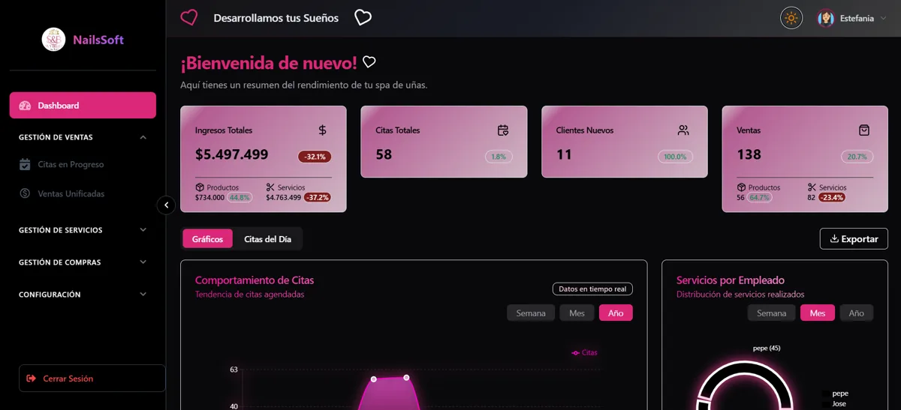

  

  
  
  

  

## 👋 Sobre mí

Soy **Tecnólogo en Análisis y Desarrollo de Software del SENA**. En mi práctica en **EDN Colombia** construí y administré una plataforma interna completa: desde la base de datos hasta la app de escritorio, los robots y los reportes que reciben los aliados.

- 🛠️ Lo que más disfruto: **convertir procesos manuales y repetitivos en sistemas que funcionan solos**.
- 🤖 Trabajo con **robots RPA**, **IA para leer documentos** y **APIs de Microsoft**.
- ✅ Me importa que el software sea confiable: **pruebas automatizadas, CI/CD y versiones que se actualizan solas**.
- 🌱 Ahora mismo: buscando mi siguiente rol como **desarrollador full stack o de automatización**.

## 🚀 Experiencia

### Practicante de Desarrollo de Software · EDN Colombia
abril – octubre de 2026

Diseñé y desarrollé **Astrum**, la plataforma de escritorio con la que los equipos de operación, comercial y PM gestionan certificados digitales y facturación electrónica. *El código es privado de la empresa.*

  

  

<b>Ver lo que construí, módulo por módulo</b>

 

| Módulo | Qué hace | Tecnología |
|--------|----------|-----------|
| 🤖 **Robots RPA** | Radican y renuevan certificados en portales externos, con puntos de aprobación humana, detección de captchas y evidencia de cada paso. | Playwright, Python |
| 📄 **Lectura de documentos** | Valida RUT, Cámara de Comercio y documentos de identidad leyendo los PDF con OCR e IA. | OCR, Gemini, Groq |
| 📊 **Tableros de cumplimiento** | Cruza la facturación electrónica con los errores y las intermitencias de la DIAN, con mapas de calor y filtros. | React, Recharts, PostgreSQL |
| 📬 **Reportes automáticos** | Arma y envía cada mes un reporte ejecutivo a cada aliado. | Flask, Microsoft Graph |
| 🔗 **Integraciones** | Buzón de Outlook, carpetas de SharePoint e inicio de sesión con cuenta Microsoft. | Microsoft Graph, MSAL |
| 💬 **Tiempo real** | Notificaciones y chat dentro de la app. | Socket.IO |
| 🚢 **Entrega** | Instalador firmado, actualización automática y publicación con CI/CD. | Electron, GitHub Actions |

## 🧩 Proyectos

<table>
  <tr>
    <td width="50%" valign="top">
      
    </td>
    <td width="50%" valign="top">
      <h3>💅 NailSoft</h3>
      
Proyecto de grado del SENA, en equipo de 4. Sistema <b>web y móvil</b> para un spa: citas con varios servicios, ventas, compras de insumos, reportes y <b>permisos dinámicos por rol</b>. Más de 90 en todas las métricas de Lighthouse.

      

        
        
        
        
        
      

      

        <a href="https://nailsoft-7d03c.web.app/login"><b>Ver demo</b></a> ·
        <a href="https://github.com/IHomoSapienI/ProyectoNailSoft"><b>Ver código</b></a>
      

    </td>
  </tr>
</table>

## 🧰 Tecnologías

  <b>Lenguajes</b>  
  

  <b>Frontend, backend y escritorio</b>  
  

  <b>Datos, nube y entrega</b>  
  

  
  
  
  
  

## 📫 Hablemos

Si tienes un proceso que se hace a mano y debería hacerse solo, o buscas a alguien para tu equipo, escríbeme por [LinkedIn](https://www.linkedin.com/in/frank-paternina-836640264/).

  

